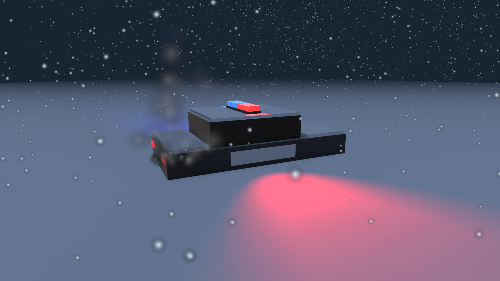
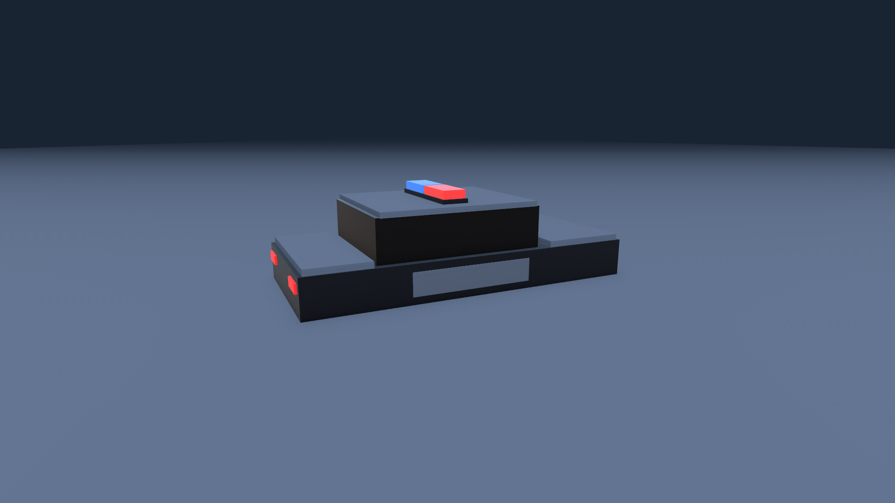
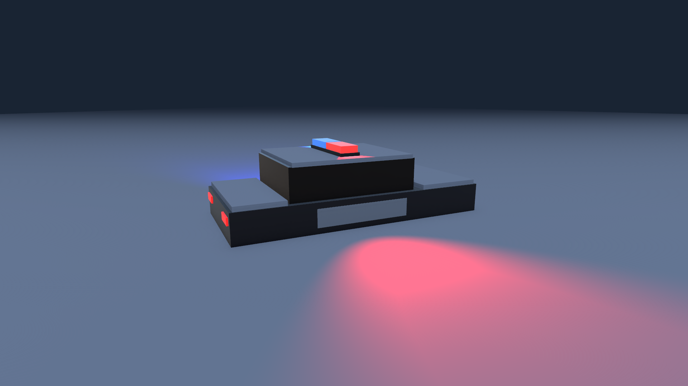

# Taller de Unity · Escena Invernal de Rescate

**Estudiante:** Alejandro Villamil Carmona · 2610338-3743
**Motor:** Unity 6000.6.7f1 con Universal Render Pipeline (URP)

Una patrulla de policía quedó atascada y semienterrada en la nieve durante una tormenta. El motor sigue encendido y echa humo por el escape, las sirenas giran sin parar y la ventisca cubre todo.



## Cómo abrir y ver la escena

1. Abrir la carpeta del proyecto con Unity Hub (versión 6000.6.7f1).
2. Abrir la escena `Assets/Scenes/EscenaInvernal.unity`.
3. Pulsar **Play**: las sirenas giran, nieva y sale humo del escape.

## Jerarquía (10 objetos)

```
Main Camera            Cámara con encuadre diagonal hacia el coche
Moon_Light             Luz direccional azul muy pálido, intensidad 0.35
Snow_Terrain           Plano de 100 x 100 m con material de nieve
Police_Car             Objeto padre vacío en Y = -0.5 (enterrado)
├── Car_Mesh           Carrocería: una sola malla con varias piezas y materiales
├── Siren_Pivot        Vacío sobre el techo, con el script SirenRotation
│   ├── Red_Light      Spot rojo, rango 25
│   └── Blue_Light     Spot azul, rango 25, apuntando al lado opuesto
└── Exhaust_Smoke      Partículas del escape, en la parte trasera
Global_Blizzard        Partículas de nieve sobre toda la escena (independiente)
```

**El coche enterrado:** `Police_Car` está en Y = -0.5. La carrocería empieza por debajo del suelo, así que la nieve llega a media puerta y no se ven las ruedas. Hay nieve acumulada sobre el techo, el capó y el maletero.

## Script `SirenRotation.cs`

Está en `Assets/Scripts/` y va asignado solo a `Siren_Pivot`. Las dos luces son hijas del pivote, así que giran con él y sus haces barren la nieve en círculo.

```csharp
public float rotationSpeed = 180f;   // grados por segundo, editable en el Inspector

void Update()
{
    transform.Rotate(Vector3.up, rotationSpeed * Time.deltaTime);
}
```

Multiplicar por `Time.deltaTime` hace que la velocidad no dependa de los FPS.

## Partículas

| Sistema | Configuración |
|---|---|
| `Global_Blizzard` (nieve) | Shape **Box** de 30 x 30 m a 12 m de altura, emitiendo hacia abajo. Gravedad 0.1, velocidad inicial variable (1 a 2.5), 3.500 copos por segundo, color blanco con tono azul claro, viento lateral (Velocity over Lifetime) y Noise para los remolinos |
| `Exhaust_Smoke` (escape) | Shape **Cone** muy estrecho (6°, radio 0.04). **Color over Lifetime** de gris oscuro a transparente, **Size over Lifetime** creciente (de 0.5x a 2.5x), gravedad negativa para que suba, y ráfagas irregulares: el motor "tose" por el frío |

Los parámetros de las partículas se definieron con asistencia de IA, como permite el enunciado.

## Evolución de la escena

| Terreno y coche enterrado | Sirenas | Escena final |
|---|---|---|
|  |  |  |

## Pruebas

En `Assets/Tests/PlayMode/` hay tres pruebas automáticas (Window > General > Test Runner > PlayMode):

| Prueba | Qué comprueba |
|---|---|
| `LaJerarquiaEsLaDelTaller` | Exactamente 10 objetos con los nombres y padres del enunciado; `Police_Car` con Y negativa; las sirenas apuntan a lados opuestos |
| `LaSirenaGira` | Hay un solo `SirenRotation` y está en `Siren_Pivot`; `rotationSpeed` es pública; el pivote gira `rotationSpeed × tiempo` (90° en 0.5 s a 180°/s) y la luz roja se mueve en círculo |
| `LasParticulasEmiten` | Los dos sistemas emiten; la nieve usa Box y cae, el humo usa Cone con Color y Size over Lifetime |

## Estructura

```
Assets/
  Scenes/EscenaInvernal.unity   la escena
  Scripts/SirenRotation.cs      rotación de las sirenas
  Materials/                    nieve, carrocería, luces y partículas (URP)
  Models/PoliceCar.asset        malla de la patrulla
  Editor/                       herramientas del menú "Taller": construir la escena por etapas y capturar imágenes
  Tests/PlayMode/               pruebas automáticas
Capturas/                       imágenes de cada etapa
```

**Herramientas de apoyo:** se usó Claude Code (IA) para los parámetros de las partículas y para los scripts de editor que construyen y verifican la escena.
